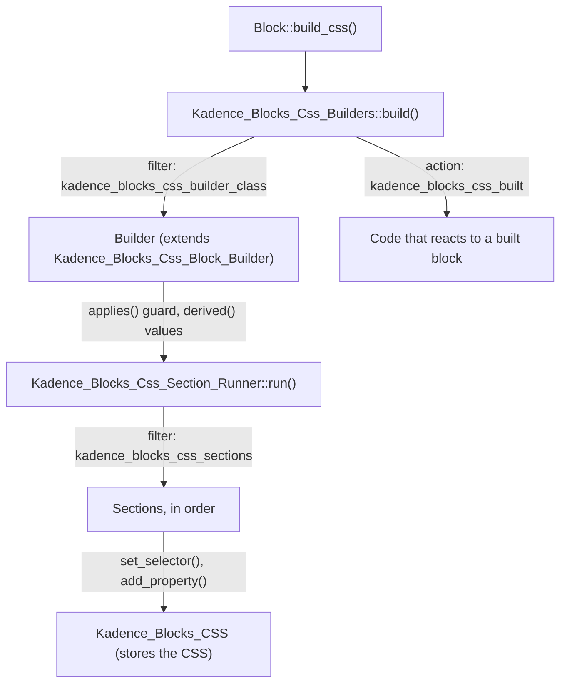

# CSS builders

Every block's `build_css()` is one line:

```php
return Kadence_Blocks_Css_Builders::build( 'Kadence_Blocks_X_Css', $this, $this->block_name, $attributes, $css, $unique_id, $unique_style_id );
```

What happens next, in short:

* `Kadence_Blocks_Css_Builders` loads the builder class on demand and gives it a `Kadence_Blocks_Css_Block_Context`, which
  reaches the block's public helper methods through `Kadence_Blocks_Css_Block_Bridge`.
* A builder extends `Kadence_Blocks_Css_Block_Builder`, which owns the `build()` template (input, style id, write each
  section in order). It only declares `sections()`, and `applies()` (a guard, for blocks that read a post) and `derived()`
  (values worked out once from the attributes and the unique id) when it needs them.
* Each `Kadence_Blocks_Css_Section` writes one group of rules through `Kadence_Blocks_Css`. Generic sections live in
  `sections/` and are reused by Kadence Blocks Pro.
* Blocks whose CSS is the same share a builder, such as `Kadence_Blocks_Form_Field_Css` for the advanced form fields.

## How the CSS of a block is built



A block hands its attributes to the factory; the builder lists the sections; each section writes one group of rules. Blocks
reach their own helpers (such as `class_id()`) only through public methods, called through the block context.

## Extending the CSS of a block

The hooks below are public. Their names and arguments only ever grow (see the additive-only rule above), and
`tests/wpunit/CssBuilders/Hooks/HooksTest.php` pins them. `$block_name` is the block name without its namespace, such as
`infobox` or `header-column`.

| Hook | Kind | What it is for |
|---|---|---|
| `kadence_blocks_css_sections` (`$sections`, `$block_name`, `$attributes`) | filter | Add, remove, replace or reorder the sections that write a block's CSS. Items must implement `Kadence_Blocks_Css_Section`; anything else is dropped with a `_doing_it_wrong` notice. Applies to the top-level sections of every block builder. |
| `kadence_blocks_css_builder_class` (`$builder_class`, `$block_name`, `$block`) | filter | Replace the builder class of a block. The class must exist, take a `Kadence_Blocks_Css_Block_Context` in its constructor and have a `build()` method; extending `Kadence_Blocks_Css_Block_Builder` does all of that. |
| `kadence_blocks_css_built` (`$block_name`, `$attributes`, `$output`, `$unique_id`) | action | React to a block being built, for example to load assets or keep a log. The CSS itself is already stored by the CSS builder. |
| `kadence_blocks_css_output_media_queries` | filter | Existing: switch the media query output off. |
| `kadence_blocks_attachment_fixed_on_mobile` | filter | Existing: keep a fixed background fixed on mobile. |

Add a section to a block:

```php
add_filter(
	'kadence_blocks_css_sections',
	static function ( array $sections, string $block_name ) {
		if ( 'infobox' === $block_name ) {
			$sections[] = new My_Plugin_Infobox_Glow_Section();
		}

		return $sections;
	},
	10,
	2
);
```

A section implements `Kadence_Blocks_Css_Section::write( Kadence_Blocks_Css_Build_Input $input )`. It reads the attributes
from `$input`, sets a selector (`$input->css()->set_selector()`, `{id}` stands for the unique id in the selector
sections) and adds properties. Sections share one CSS builder and its current selector, so a section that adds properties
needs a selector before it, from `Kadence_Blocks_Css_Selector_Section` or its own `set_selector()`.

Build the CSS of a block from another plugin the same way Kadence Blocks Pro does: write a builder that extends
`Kadence_Blocks_Css_Block_Builder` and lists its sections, make it loadable (a class map registered with
`Kadence_Blocks_Css_Builders::add_classmap()`, or any autoloader), and have the block's `build_css()` call
`Kadence_Blocks_Css_Builders::build( 'My_Plugin_Block_Css', $this, $this->block_name, $attributes, $css, $unique_id, $unique_style_id )`.

### Sections you can reuse

Another plugin does not have to write every section. These generic ones live in `sections/`; the docblock of each class
says what its arguments mean, and `tests/wpunit/CssBuilders/Hooks/ThirdPartyTest.php` builds a block from some of them.

| Section | Writes |
|---|---|
| `Kadence_Blocks_Css_Selector_Section( $selectors )` | Sets the selector the sections after it write under. `{id}` stands for the block unique id. |
| `Kadence_Blocks_Css_Static_Section( $property, $value )` | One property with a value that never changes. |
| `Kadence_Blocks_Css_Color_Section( $property, $attribute )` | A color property when its attribute is not empty. |
| `Kadence_Blocks_Css_Responsive_Range_Section( $attribute, $property, $unit_attribute )` | A width or size saved per device, with its unit. |
| `Kadence_Blocks_Css_Range_Section( $attribute, $property, $unit )` | A range attribute as a size with a unit. |
| `Kadence_Blocks_Css_Gap_Section( $attribute, $property, $unit_attribute, $arguments = [] )` | A gap with its unit. |
| `Kadence_Blocks_Css_Measure_Section( $property, $attribute, $arguments = [] )` | Padding, margin or border radius saved as four sides. |
| `Kadence_Blocks_Css_Typography_Section( $attribute )` | The typography saved in one attribute. |
| `Kadence_Blocks_Css_Text_Align_Section( $attribute, $arguments )` | The text alignment of every device. |
| `Kadence_Blocks_Css_Enabled_Section( $attribute, $sections )` | Runs sections only while a switch attribute is on. |
| `Kadence_Blocks_Css_Gate_Section( $keys, $sections )` | Runs sections only when one of a list of attributes was saved. |
| `Kadence_Blocks_Css_Choice_Section( $condition, $then, $otherwise )` | Runs one set of sections when a condition is met and another when it is not. |
| `Kadence_Blocks_Css_Device_Section( $device, $sections )` | Runs sections for `tablet` or `mobile`, then returns to desktop. |
| `Kadence_Blocks_Css_Item_Section( $attribute, $index, $sections )` | Runs sections when one entry of a list attribute is filled. |

### What you can rely on

Only the following are public API, and they only ever grow: the `Kadence_Blocks_Css_Section` interface,
`Kadence_Blocks_Css_Build_Input` (`attribute()`, `attributes()`, `item()`, `css()`, `unique_id()`, `unique_style_id()`,
`derived()`, `context()`), `Kadence_Blocks_Css_Block_Builder` (`sections()`, `applies()`, `derived()`),
`Kadence_Blocks_Css_Builders` (`build()`, `add_classmap()`), `Kadence_Blocks_Css_Section_Runner::run()`, the sections in
the table above, and the hooks. The sections and builders named after one block (`Kadence_Blocks_Infobox_*`,
`Kadence_Blocks_Pro_Slider_*`) are shared between Kadence Blocks and Kadence Blocks Pro and are kept compatible
between the two, but are not meant to be a stable API for other plugins: use the generic sections or write your own.

## Adding a builder for a new block

1. **Write the builder** in `includes/css-builders/class-kadence-blocks-<name>-css.php`: a `final class Kadence_Blocks_<Name>_Css extends Kadence_Blocks_Css_Block_Builder`
   whose `sections()` returns the sections in the order they are written (a selector section first, then the sections that write
   under it). Reuse the generic sections listed above; put a section that is only for this block in a folder named after the block
   (`includes/css-builders/<name>/class-kadence-blocks-<name>-<what>.php`). One class per file, no `require`.
2. **Make it loadable.** Regenerate the class map and commit it:

   ```bash
   php bin/generate-css-classmap.php includes includes/css-builders/classmap.php css-builders css-writers
   ```

   `tests/wpunit/CssBuilders/Classmap/ClassmapTest.php` fails until you do. In Kadence Blocks Pro use the same command with only `css-builders`.
3. **Call it from the block**: `build_css()` is the one line shown at the top. The helpers the builder needs from the block (such as
   `class_id()` or `enqueue_script()`) must be public methods of the block; the builder reaches them with
   `$this->context->call( 'method', ... )`.
4. **Test it.** Add a test next to the others in `tests/wpunit/CssBuilders/<Name>/`: extend `Entry_Build_Test_Case` to build the whole block
   (`build_entry()`), or `Free_Section_Test_Case` to write one section (`write_section()`), and assert the CSS with `assertSameCss()`. Run it:

   ```bash
   vendor/bin/codecept run wpunit CssBuilders/<Name>
   ```
5. **Pin it** when the block has a `block.json` (it is then built from generated attributes by `BuildCssGoldenMasterTest`). Recording writes what the block does now:
   its CSS, and the Google fonts, scripts and styles it queues and the filter results it causes. Commit the data file that appears in `tests/_data/build-css-golden/`:

   ```bash
   BUILD_CSS_GOLDEN_WRITE=1 BUILD_CSS_ONLY=Kadence_Blocks_<Name>_Block vendor/bin/codecept run wpunit BuildCssGoldenMasterTest.php
   ```

   Use `BUILD_CSS_GOLDEN_WRITE=fonts` instead only to add the fonts, queues and filters to a data file that already exists, when you must not
   re-record its CSS (for example after the original code was the reference).
6. **Before you merge:** the whole suite (`vendor/bin/codecept run wpunit`), `phpcs` on the new files, and, when a class that Kadence Blocks Pro uses changed,
   `php bin/bundle-css-runtime.php` in Pro (`RuntimeTest` fails when the bundled copy drifted). A new public method of a shared class also needs
   `KB_UPDATE_API_SNAPSHOT=1` once, and a row in the README when it is a hook or a reusable section.

## Maintaining this code

### Updating Free and Pro in any order

* Classes load through a generated class map, never through `require_once`: no file in `css-builders/` or `css-writers/`
  requires anything. Each plugin registers its map with `Kadence_Blocks_Css_Builders::add_classmap()`. After adding,
  moving or removing a class run `php bin/generate-css-classmap.php includes includes/css-builders/classmap.php css-builders css-writers`
  (Pro: `... css-builders`); `ClassmapTest` fails when a map is stale.
* Pro bundles a copy of the Free runtime classes in `kadence-blocks-pro/includes/css-runtime/`. Its autoloader
  (`Kadence_Blocks_Pro_Css_Runtime`) uses Free's file when it exists and the bundled copy otherwise, so old Free +
  new Pro works.
* New Free + old Pro works because Free's `build_css()` bodies never depend on Pro and the public API only grows.
* **Additive-only rule:** never remove, rename, or add required parameters to a public method of a class in
  `css-builders/` or `css-writers/`. `tests/wpunit/CssBuilders/Api/ApiContractTest.php` enforces this against
  `css-builders-api.json`. After an intentional addition run the suite with `KB_UPDATE_API_SNAPSHOT=1` and bump
  `KADENCE_BLOCKS_CSS_BUILDERS_VERSION`.
* After changing a shared Free class, run `php bin/bundle-css-runtime.php` in Pro; `RuntimeTest` fails if the bundle drifts.

### PHP versions

The plugins support PHP 7.4 and later; the tests and their recordings run on PHP 8.x.

* The matrix tests and the golden masters were recorded from the original code on PHP 8. That code compares loosely
  (`0 == 'row'` is true on 7.4 and false on 8), so for odd attribute values it gives other CSS on PHP 7.4 than on PHP 8. They
  are marked `@requires PHP >= 8.0` and are skipped on 7.4, with the reason in their docblock. A few tests that pin the
  `TypeError` PHP 8 throws for garbage input carry the same mark.
* The new code behaves on PHP 7.4 exactly as the original code does there. That is checked by running the original tree and the
  new tree side by side on PHP 7.4 over the same generated attributes (about 400 cases per block) and comparing the CSS and the
  Google fonts. Run it again after a change to a builder: the PHP 7.4 test image and the comparison tests live in
  `~/kadence-test` of the maintainer (`Dockerfile.php74`, `compose-php74.yml`, `compose-orig74.yml`, `CssDumpTest.php`,
  `FontsDumpTest.php`); the Pro tests and the block tests that do not depend on the recordings run on 7.4 as they are.
* Run `php -l` on PHP 7.4 over the changed files at least; the PHP compatibility check of the CI (PHPCompatibility 9.3.5) does not
  know the syntax and the functions that PHP 8 added, such as `match` and `str_contains`.
